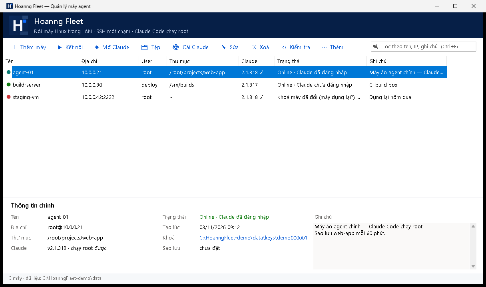
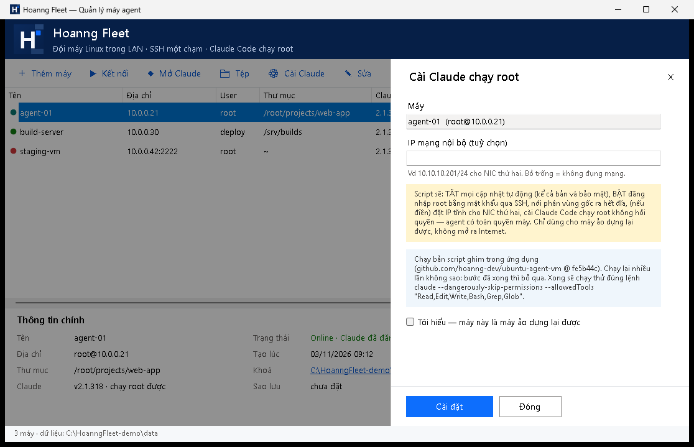

<p align="center">
  
</p>

<h1 align="center">Hoanng Fleet</h1>

<p align="center">
  <b>Quản lý đội máy Linux trong LAN từ Windows — SSH một chạm, Claude Code chạy root, quản lý tệp kiểu FileZilla, sao lưu tự động.</b><br>
  <i>A tiny Windows app to manage a fleet of Linux machines: one-click SSH, Claude Code as root, FileZilla-style file manager, scheduled backups.</i>
</p>

<p align="center">
  <a href="../../releases/latest"></a>
  
  
</p>



## Hoanng Fleet là gì?

Bạn có vài máy Linux / máy ảo Ubuntu trong mạng nội bộ (máy build, máy chạy agent AI, máy thử nghiệm…) và muốn:

- **Bấm một lần là vào SSH**, không phải nhớ IP, không gõ mật khẩu mỗi lần.
- **Mở Claude Code ngay trên máy đó** (kể cả chạy dưới root với `--dangerously-skip-permissions`) ở đúng thư mục dự án.
- **Duyệt, tải lên, tải về tệp** giữa Windows và máy Linux như FileZilla.
- **Sao lưu chủ động** một thư mục dự án về máy Windows — bấm tay hoặc tự chạy định kỳ.

Hoanng Fleet gói tất cả vào **một tệp `.exe` ~160 KB**, không cần cài đặt, không cần thư viện ngoài — chỉ dùng OpenSSH có sẵn trong Windows.

## Tính năng (v1.0.0)

### Danh sách máy
- Thêm / sửa / xoá / ghi chú từng máy, tìm kiếm nhanh, chấm màu trạng thái (online, đang kiểm, lỗi).
- **Mỗi máy một khoá SSH ed25519 riêng.** Mật khẩu chỉ dùng **một lần** để cài khoá, giữ trong bộ nhớ, **không lưu ở đâu**.
- Khung **Thông tin chính**: địa chỉ, thư mục mặc định, phiên bản Claude, trạng thái, lần sao lưu gần nhất, ghi chú.
- **Kiểm tra** (F5): máy còn kết nối không, Claude Code bản nào, đã đăng nhập chưa.
- Báo lỗi dễ hiểu: sai mật khẩu, máy tắt, khoá bị gỡ, **máy dựng lại cùng IP (khoá máy đổi)** — kèm cách xử lý.
- **Cài lại khoá** cho máy vừa cài lại / khoá bị lộ (có cảnh báo MITM, không tự tin khoá máy mới).
- **Nhập kết nối có sẵn** (thư mục chứa `id_ed25519` + `known_hosts`), **sao lưu / khôi phục** cả danh sách ra tệp zip.
- Xoá máy an toàn: khoá chuyển vào `data\trash`, gỡ khoá trên máy có **sao lưu `authorized_keys`** và không bao giờ gỡ khoá cuối cùng.

### Kết nối & Claude Code
- **Kết nối** (Enter / nhấp đúp) và **Mở Claude** (Ctrl+Enter) mở thành **tab Windows Terminal** đặt đúng **tên máy** (tab Claude thêm “· Claude”, có màu riêng), tên tab không bị bash/Claude đổi.
- **Mở Claude ở thư mục bất kỳ** — chọn trên cây thư mục rồi bấm “◆ Claude ở đây”.
- **Cài Claude chạy root** cho máy ảo Ubuntu (tuỳ chọn, có cảnh báo bắt buộc tích): chạy script [`ubuntu-agent-vm`](https://github.com/hoanng-dev/ubuntu-agent-vm) **được ghim sẵn trong exe** (commit `fe5b44c`), rồi chạy thử đúng lệnh:
  ```
  claude --dangerously-skip-permissions --allowedTools "Read,Edit,Write,Bash,Grep,Glob"
  ```
- **Cập nhật Claude Code** lên bản mới nhất bằng một nút.

### Quản lý tệp (kiểu FileZilla)
- Cửa sổ **chia đôi**: bên trái là **máy Windows này**, bên phải là **máy SSH** — cả hai đều có **cây thư mục** + danh sách tệp.
- **⬆ Tải lên →** / **⬇ Tải về ←** áp dụng cho các tệp / thư mục **đã chọn ở mỗi bên**; kéo thả giữa hai bên, kéo từ Windows Explorer vào bên phải, nhấp đúp tệp để chuyển sang bên kia.
- Hỏi khi trùng tên (ghi đè / bỏ qua), giữ nguyên giờ sửa của tệp, hỗ trợ tên tiếng Việt và dấu cách.

### Đồng bộ sao lưu (tuỳ chọn)
- Chọn thư mục trên máy SSH → thư mục trên Windows; **chỉ tải tệp mới / đã đổi** (so kích thước + giờ sửa).
- Bỏ qua `node_modules`, `.cache`… (tuỳ chỉnh được); chế độ **gương** chuyển tệp đã xoá trên máy vào `.hf-trash` (không xoá hẳn).
- **Tự sao lưu mỗi N phút** bằng Windows Task Scheduler — chạy cả khi ứng dụng đóng (`HoanngFleet.exe --sync <id>`), có nhật ký riêng. Bạn tự quyết bật hay không.

| Thêm / cài máy agent | Quản lý tệp |
|---|---|
|  | Hai nửa Windows ↔ SSH, mỗi bên một cây thư mục |

## Tải về & dùng

1. Tải `HoanngFleet.exe` ở mục **[Releases](../../releases/latest)**.
2. Đặt vào một thư mục **ghi được** (vd `C:\Tools\HoanngFleet\`), bấm đúp để chạy. Ứng dụng tạo thư mục `data\` bên cạnh để lưu danh sách máy và khoá.
3. Bấm **＋ Thêm máy** → nhập IP, user, mật khẩu (một lần) → xong. Từ giờ bấm **Kết nối** hoặc **Mở Claude**.

**Yêu cầu**

| | |
|---|---|
| Windows | 10 / 11 / Server 2019+ (có .NET Framework 4.x — có sẵn) |
| OpenSSH Client | có sẵn trên Windows 10/11; thiếu thì *Settings › Apps › Optional features › OpenSSH Client* (cần ≥ 8.4) |
| Windows Terminal | tuỳ chọn — có thì kết nối mở thành tab đặt tên theo máy; không có thì mở cửa sổ cmd |
| Máy đích | Linux/Unix có SSH; cho phép đăng nhập mật khẩu ở lần thêm đầu tiên |

**Phím tắt:** Ctrl+N thêm · Enter kết nối · Ctrl+Enter Claude · Ctrl+O tệp · F2 sửa · Del xoá · F5 kiểm tra · Ctrl+F tìm · Esc đóng.

## Bảo mật — đọc trước khi dùng

- **Khoá riêng** nằm ở `data\keys\<máy>\id_ed25519`, phân quyền **chỉ tài khoản Windows hiện tại** đọc được, không đặt passphrase: ai đăng nhập được tài khoản Windows đó là vào được các máy. Đừng chia sẻ thư mục `data\`; bản sao lưu zip **chứa khoá riêng** — cất nơi an toàn.
- `data\machines.json` **không chứa mật khẩu**. Mật khẩu chỉ đi qua biến môi trường của tiến trình ssh trong lúc cài khoá.
- Mỗi máy có `known_hosts` riêng với `StrictHostKeyChecking=yes`: khoá máy đổi thì **dừng lại và báo**, không tự tin.
- **Cài Claude chạy root** cố ý bỏ hàng rào an toàn của máy đích: **tắt mọi cập nhật tự động (kể cả bản vá bảo mật)**, **bật đăng nhập root bằng mật khẩu**, nới phân vùng, cho Claude Code toàn quyền không hỏi. **Chỉ dùng cho máy ảo dựng lại được, không mở ra Internet.**

## Tự build từ mã nguồn

Không cần Visual Studio — dùng trình biên dịch C# có sẵn trong Windows:

```bat
git clone https://github.com/hoanng-labs/hoanng-fleet
cd hoanng-fleet
build.cmd
:: → dist\HoanngFleet.exe
```

```
src/HoanngFleet.cs                 toàn bộ ứng dụng (WinForms, .NET Framework 4.x, C# 5)
assets/logo.ico, logo-128.png      biểu tượng
scripts/setup-ubuntu-agent-vm.sh   script cài máy agent (bản ghim, nhúng vào exe)
build.cmd                          build bằng csc.exe của Windows
```

## Lộ trình

Đây là **phiên bản đầu tiên (v1.0.0)**. Sẽ cập nhật dần — góp ý / báo lỗi tại [Issues](../../issues).

## Giấy phép

[MIT](LICENSE) © 2026 [Hoanng Labs, Inc.](https://hoanng.dev)

---

### English summary

**Hoanng Fleet** is a single ~160 KB Windows executable (no install, uses the built-in OpenSSH) to manage a small fleet of Linux machines:
one-click SSH and Claude Code sessions in Windows Terminal tabs named after each machine, per-machine ed25519 keys (the password is used once and never stored),
an optional "agent VM" provisioner that lets Claude Code run as root with `--dangerously-skip-permissions` on disposable Ubuntu VMs,
a FileZilla-style two-pane file manager (Windows ↔ SSH, both with folder trees, drag & drop), and incremental folder backups that can run on a schedule via Task Scheduler.
Build from source with `build.cmd` (uses the C# compiler shipped with Windows). MIT licensed.
